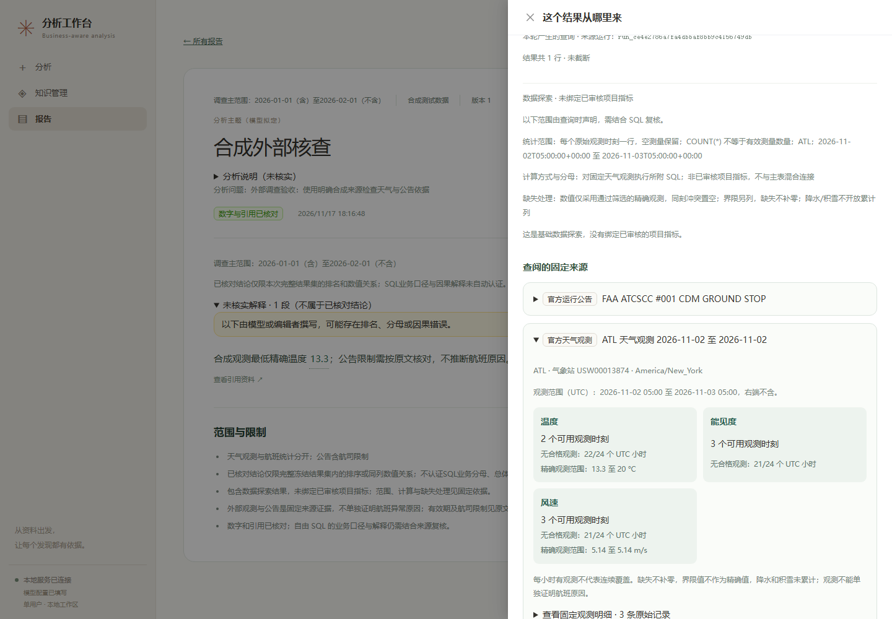
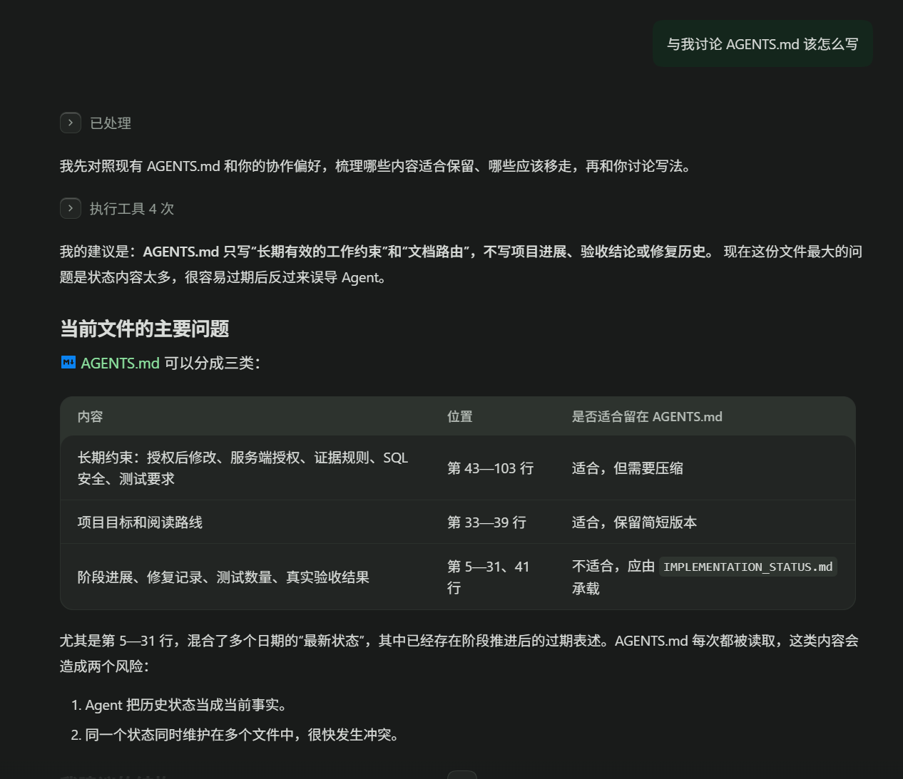
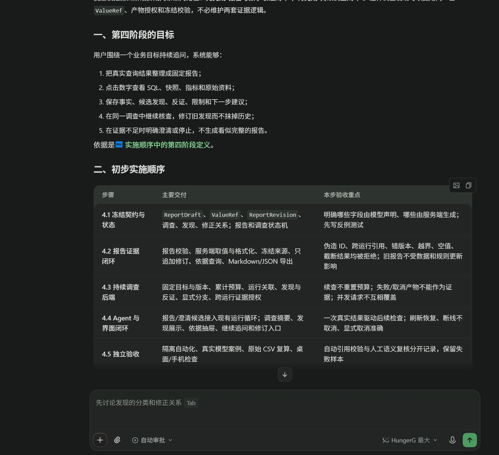
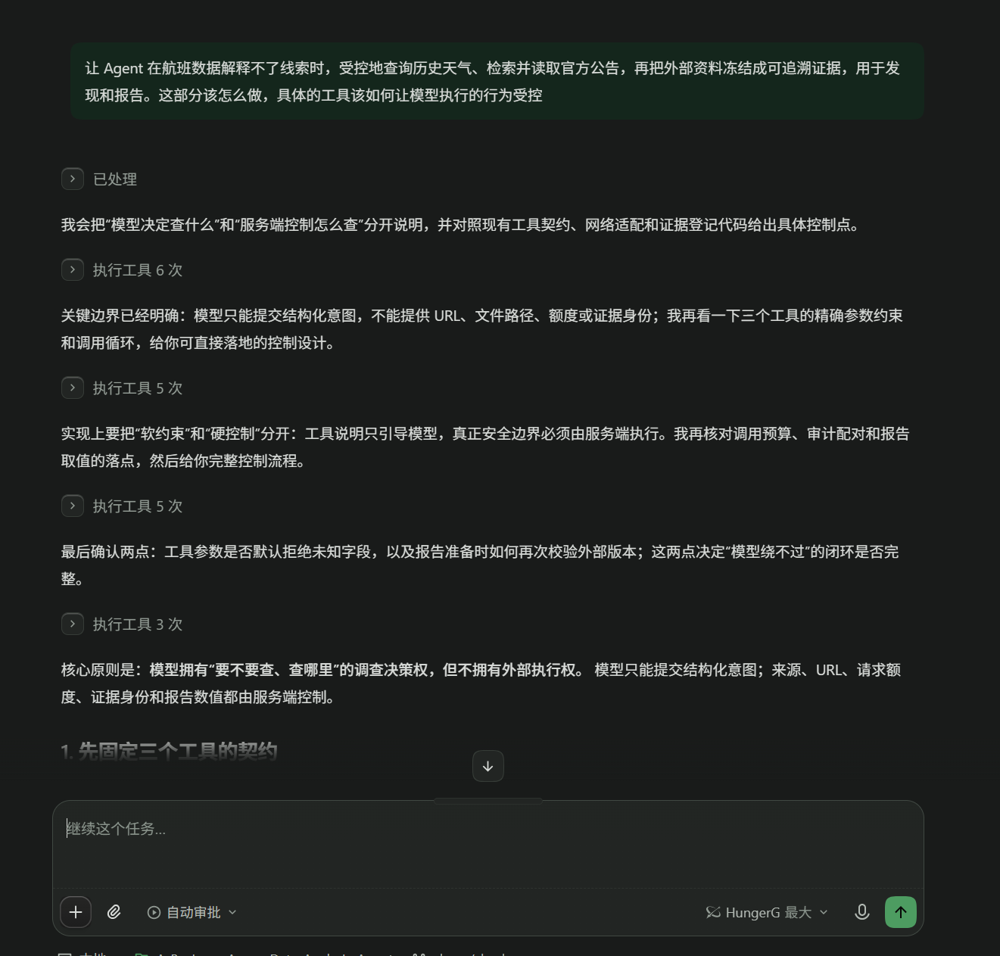
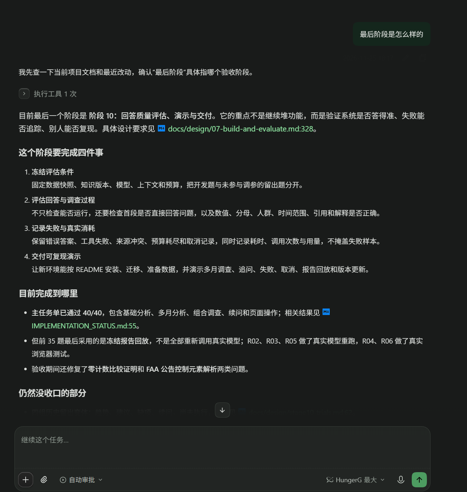

# Caliber：让每个业务结论，都能回到数据依据

## 1. 自我介绍

我们是陈文浩和卢逸峰，华南理工大学的2024级本科生。我们喜欢把业务问题拆成三件事：数据能回答什么、现有证据能支持什么、还有什么暂时无法确定。A-Business-Aware-Data-Analysis-Agent 就是我把这个思路做成完整产品的实践。

## 2. 我的作品是什么

**Caliber 是一款面向航班运营分析人员的本地 AI 调查工作台：他们用自然语言提出取消率、延误、机场或航司比较等问题，系统会查阅业务资料、执行受控 SQL，并根据真实结果继续核查，最终生成每个数字都能回查依据的报告。**

它不是“问一句、给一段话”的聊天机器人，而是一条完整的调查链路：

**提出目标 → 查阅资料与数据 → 按结果继续核查 → 保存证据与限制 → 生成可追溯报告 → 在同一调查中继续追问。**

当前演示数据采用 BTS Reporting Carrier 月度航班数据，并可结合已登记的天气观测和 FAA ATCSCC 公告进行外部核查。

## 3. 为什么做

传统 BI 擅长回答固定报表，通用聊天机器人擅长组织语言，但两者之间往往缺少一段可靠的过程：

- 业务口径没有随问题一起固定，容易换一个分母就得出不同结论；
- 模型能生成流畅解释，却可能编造名次、因果或没有出处的数字；
- 一次查询失败、资料缺失或范围变化后，后续回答容易丢失上下文；
- 报告看起来完整，但评委或使用者无法回查“这个数究竟从哪里来”。

我想做的，是一个**让模型决定下一步、让系统守住执行和证据边界**的分析助手。模型负责理解目标、选择工具和根据结果调整调查方向；服务端负责校验 SQL、固定数据版本、保存成功产物，并从冻结结果中取出报告数字。失败、缺资料和无法确定的判断也会被如实保留，而不是被包装成成功。

## 4. 怎么用

以下步骤可在 Windows PowerShell 中直接执行。准备环境：Python 3.12、uv、Node.js 22+，以及一个支持原生工具调用的 Chat Completions 兼容模型服务。

### 第 1 步：安装依赖并配置模型

在项目根目录执行：

```powershell
$OutputEncoding = [Console]::OutputEncoding = [System.Text.UTF8Encoding]::new()
$env:UV_CACHE_DIR = Join-Path (Get-Location) '.cache/uv'
uv sync --locked
if (-not (Test-Path .env)) { Copy-Item .env.example .env }
```

编辑 `.env`，填写自己的模型配置：

```dotenv
LLM_BASE_URL=https://your-provider.example/v1
LLM_API_KEY=replace-me
LLM_MODEL=your-tool-capable-model
```

### 第 2 步：初始化数据库并导入演示数据

```powershell
uv run alembic upgrade head
uv run python -m metric_pilot.data.ingest --input ./fixtures/synthetic_flight_records.csv --period YYYY-MM --synthetic --carriers ./fixtures/synthetic_airline_lookup.csv --airports ./fixtures/synthetic_airport_lookup.csv --activate
```

仓库附带的合成数据适合快速体验，不是官方航班数据，不能用于真实业务结论。

### 第 3 步：启动后端

保持项目根目录，运行：

```powershell
uv run uvicorn metric_pilot.main:app --host 127.0.0.1 --port 8000
```

### 第 4 步：启动前端

另开一个 PowerShell 终端：

```powershell
Set-Location frontend
npm.cmd ci --cache ../.cache/npm
npm.cmd run dev
```

### 第 5 步：打开页面，发起第一次调查

访问 **http://127.0.0.1:5173**，进入“分析”：

1. 在“工作区数据源”确认已选择刚导入的合成快照；
2. 点击“新调查”，选择导入快照对应的完整月份范围；
3. 输入问题：**“查看本月数据范围与缺失情况，找出值得进一步核查的异常。”**
4. 查看当前行动、工具结果和本轮发现；点击报告中的数字，打开 SQL、参数和冻结结果；
5. 在同一调查中继续追问，或导出 Markdown／JSON 报告。

更完整的安装、真实 BTS 数据接入与配置说明见 [README](README.md)。

## 5. 用 Qoder 做出来的过程

我没有把整个项目一次性丢给 Qoder，而是按“先定边界、再做纵向功能、每次验收后再继续”的方式推进。Qoder 承担了大量实现、排错、测试和文档工作；产品口径、验收标准和关键取舍由我决定。

| 开发环节 | 我负责决定什么 | 交给 Qoder 做什么 |
| --- | --- | --- |
| 产品定位 | 聚焦 BTS Reporting Carrier 航班调查，不做万能表格导入 | 把目标整理成模块边界、数据契约和可运行启动流程 |
| 数据与查询 | 必须只读、必须固定快照、不能用 `startswith('SELECT')` 冒充 SQL 校验 | 实现数据接入、多月快照、SQL AST 校验、只读执行、超时取消和冻结产物 |
| Agent 调查 | 模型可以选择下一步，但权限、ID、预算和报告取值由服务端控制 | 实现运行循环、工具注册、事件流、续查、上下文压缩和证据归属校验 |
| 报告与知识 | 数字必须能回查；正式指标必须人工审核；旧报告不能随规则更新而改变 | 实现 ValueRef 取值、报告冻结、版本与导出、文档管理及 Wiki 展示 |
| 页面与体验 | 页面要围绕“目标、行动、发现、依据、限制”展开，技术细节按需查看 | 实现分析、知识、报告页面，证据抽屉、移动端适配和 Caliber 品牌视觉 |
| 测试与验收 | 自动检查通过不等于业务语义正确，关键数字要用独立 CSV 复核 | 补单测、类型检查、构建、浏览器流程和真实模型试用，并记录失败样本 |

### 我重点改了什么

1. **把“通用数据导入”收窄为“BTS 航班调查”**：先保证一个真实场景能走通，不假装支持任意业务表。
2. **不让模型自己宣布结论正确**：排名和同列高低关系改由服务端基于完整冻结结果计算；自由解释默认放入“未核实解释”。
3. **把引用有效和语义正确分开**：数字能回查，只证明取值有依据，不自动证明分母、比较范围或因果正确。
4. **保留失败和旧版本**：失败样本、被拒绝的报告和旧报告不删除、不改写；新数据或规则不会悄悄重算历史结论。
5. **持续修正实际使用中发现的问题**：包括分组身份、缺侧比较、报告首段、长历史压缩、移动端阅读和前端品牌更名。

### 截图凭证

以下均为开发过程中保存的真实页面截图，使用合成数据，不包含模型密钥，展示 Caliber 品牌与核心功能。

**① 分析入口：固定数据快照和日期范围后再发起调查**


**② 数字取证：点击报告数字，查看 SQL、参数、统计口径和冻结结果**


**③ 外部核查：把 FAA 公告和天气观测作为固定来源展示，并保留覆盖限制**



**④ 完整报告：保留调查范围、版本、导出和继续修订入口**


### Qoder 开发流程

每一轮都按同一个顺序推进：先让 Qoder 核对现状和风险，再确定本轮边界与验收标准，然后实现、验证并留下记录。关键取舍由我确认，Qoder 负责把决策落成可运行的纵向切片。

#### 1. 把长期约束与项目进展分开

- **问题与风险**：`AGENTS.md` 里混入了阶段进展和修复历史，这些内容容易过期；如果每次都被 Agent 当作当前事实读取，可能造成误判和冲突。
- **我的取舍**：只保留长期有效的工作约束和文档阅读路线，项目进展、验收结果和修复记录集中到实施日志。
- **推进与验收**：Qoder 梳理现有内容、标出冲突风险并提出精简方案，最终形成“协作文档管约束、实施日志管现状”的分工，后续修改按这套规则记录和核对。



#### 2. 先做数据快照与安全查询底座

- **问题与风险**：Agent 的所有调查都依赖数据，如果快照不固定、查询不受控，后续再流畅的解释也没有可靠基础。
- **我的取舍**：第一阶段先完成数据导入、快照和受控查询，不急着做 Agent；查询必须经过 AST 白名单校验，并通过只读子进程执行，限制时间、内存、结果大小，支持真实取消。
- **推进与验收**：Qoder 实现合成数据与真实 BTS 数据接入、原始表与业务视图、来源清单和哈希、SQL 防护及冻结产物，并围绕非法 SQL、只读执行、超时取消、结果截断和失败不留证据补检查。


#### 3. 暂不引入 SDK，保留现有适配层

- **问题与风险**：接入原生工具调用后，是否需要再引入官方 SDK？新依赖可能简化部分调用，也可能破坏已有的取消、脱敏和协议控制。
- **我的取舍**：继续使用 OpenAI 兼容 API，保留 `httpx` 适配层；只有出现明确能力缺口时，才考虑增加 SDK。
- **推进与验收**：Qoder 核对现有调用契约、依赖和最小接入方案，并指出替换 SDK 的影响面；验收重点放在流式调用、工具消息配对、取消和错误处理，而不是“是否使用了 SDK”。


#### 4. 用已有契约决定下一阶段能接什么

- **问题与风险**：下一阶段如果只按功能名称讨论，很容易重复建设，或者接上阶段一留下的接口后才发现边界不一致。
- **我的取舍**：从 `RunContext`、配置、数据库、API 壳、`knowledge_snapshot_id` 和种子材料清单这些实际接口出发，先明确哪些能复用、哪些必须新增，再确定实施范围。
- **推进与验收**：Qoder 阅读设计文档、代码讲解和阶段验收记录，整理接口边界与依赖关系，形成下一阶段的详细设计；验收以契约是否闭合为准，而不是以模块是否看起来完整为准。


#### 5. 先打通受控调查闭环，再接报告

- **问题与风险**：Agent 循环如果只有“模型继续调用工具”的外观，却没有明确权限、预算和证据规则，运行越久越难排查，也越容易失控。
- **我的取舍**：把调查能力拆成可验证的纵向切片，先用 FakeLLM 跑通完整链路，再接真实模型；模型决定下一步，服务端控制 ID、快照、权限和预算，失败查询不能产生证据产物。
- **推进与验收**：Qoder 实现运行循环、工具注册、事件流和状态收尾，并检查消息配对、预算耗尽、失败恢复、重跑状态和 `QueryArtifact` 的生成条件，确保每一步都能回放和审计。


#### 6. 先冻结证据链，再做持续调查与页面

- **问题与风险**：报告如果直接采信模型生成的数字，或者续查时悄悄更换数据和规则，历史结论就会失去可信度。
- **我的取舍**：先固定 `ReportDraft`、`ValueRef` 和 `ReportRevision` 契约，完成“查询结果—报告数字—冻结来源”的证据闭环，再接入持续调查、分支和页面；旧报告不随新数据或新规则重算。
- **推进与验收**：Qoder 实现服务端取值与格式化、引用校验、来源冻结、只追加修订和 Markdown／JSON 导出，并接通续查、分支、证据抽屉与报告页面；验收同时覆盖自动检查、真实模型运行、独立 CSV 复核和桌面／手机页面操作。



#### 7. 把工具说明与强制执行分开

- **问题与风险**：工具说明只能引导模型，不能替代安全边界；如果模型可以直接提供 URL、文件路径、额度或证据身份，受控执行就会失效。
- **我的取舍**：工具 Schema 作为“软约束”，服务端校验作为“硬约束”；未知工具和未知字段默认拒绝，模型只能提交结构化意图，来源、URL、请求额度、证据身份和报告数值都由服务端决定。
- **推进与验收**：Qoder 对照工具契约、注册表和调用循环找出具体控制点，把参数校验、执行和结果登记分开，并在报告生成前再次核验外部来源版本；检查覆盖未知工具、越界字段、跨运行引用和来源不适用等情况。



#### 8. 压缩上下文，但不改变 Turn 语义

- **问题与风险**：上下文压缩容易被误解为一次新的模型轮次，从而让轮次、预算和工具执行顺序变得难以解释。
- **我的取舍**：自动压缩是当前 Turn 的请求前处理，不独立成轮、不占用 `maxTurns`、不改变 `turn` 序号；压缩成功后继续同一个 Turn，失败则按既有边界回退。
- **推进与验收**：Qoder 追踪压缩控制器与运行循环，明确触发条件、工具消息配对、检查点和失败回退；当前实现同时覆盖自动容量触发和手动命令，并分别记录真实用量与容量诊断，不把“容量通过”当作“语义正确”。


#### 9. 验收回答质量，而不是继续堆功能

- **问题与风险**：最后阶段如果继续加功能，就无法证明系统是否真的答得准、失败能否追踪、别人能否复现；自动检查通过也不等于业务语义正确。
- **我的取舍**：冻结数据、知识、模型、上下文和预算，分开开发问题与留出问题；不仅检查能否运行，还检查是否直接回答问题，以及数值、分母、人群、时间范围、引用和解释是否正确，同时保留失败样本和真实消耗。
- **推进与验收**：Qoder 协助整理任务集、独立复算、回归与报告重放，并分别记录自动测试、真实模型、浏览器和人工语义复核；主任务单已完成验收，但部分历史结果以冻结报告回放核对，留出变体、岗位人员评价和最终交付收口仍未完成。


