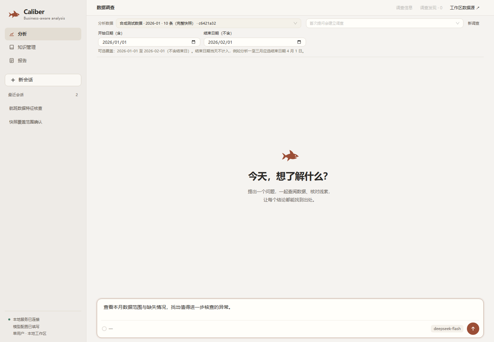
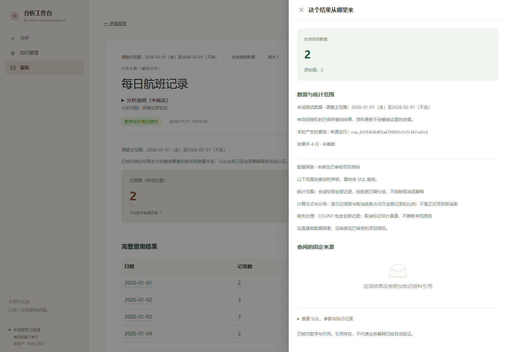
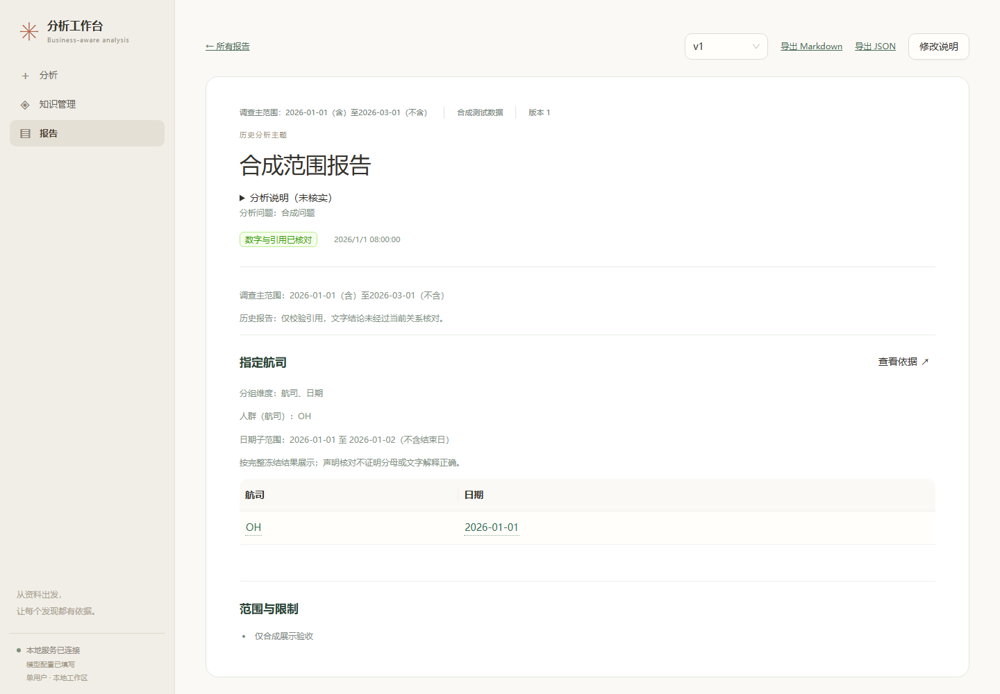
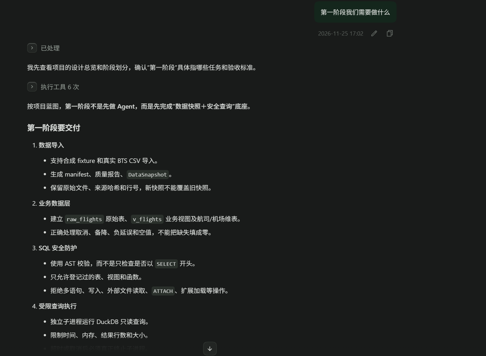
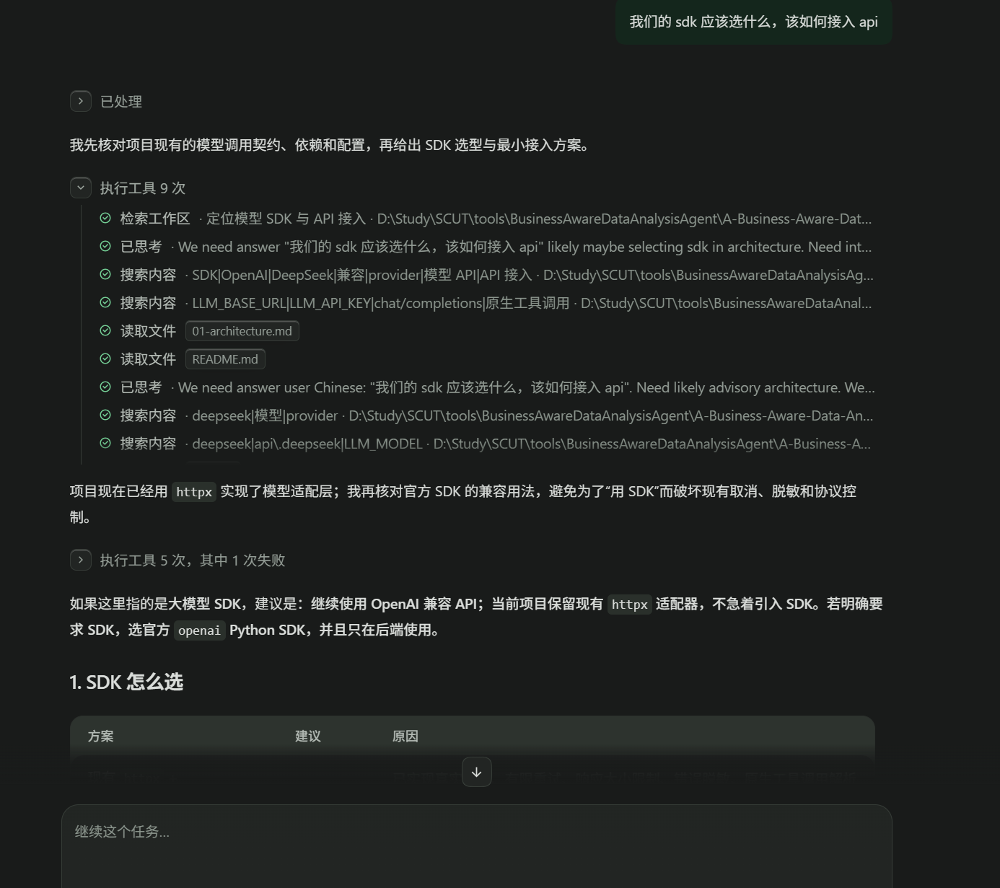
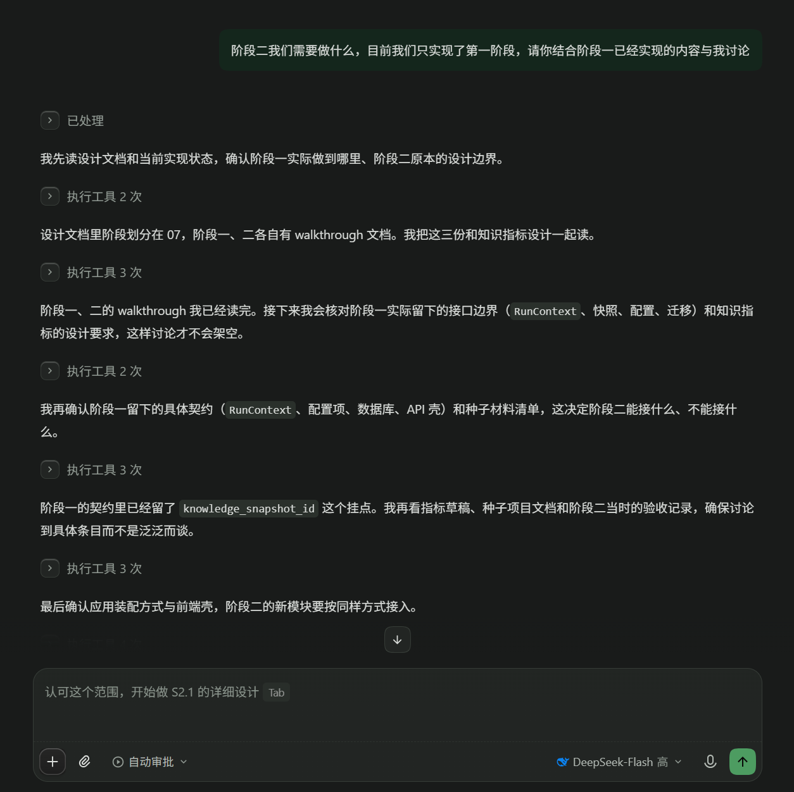
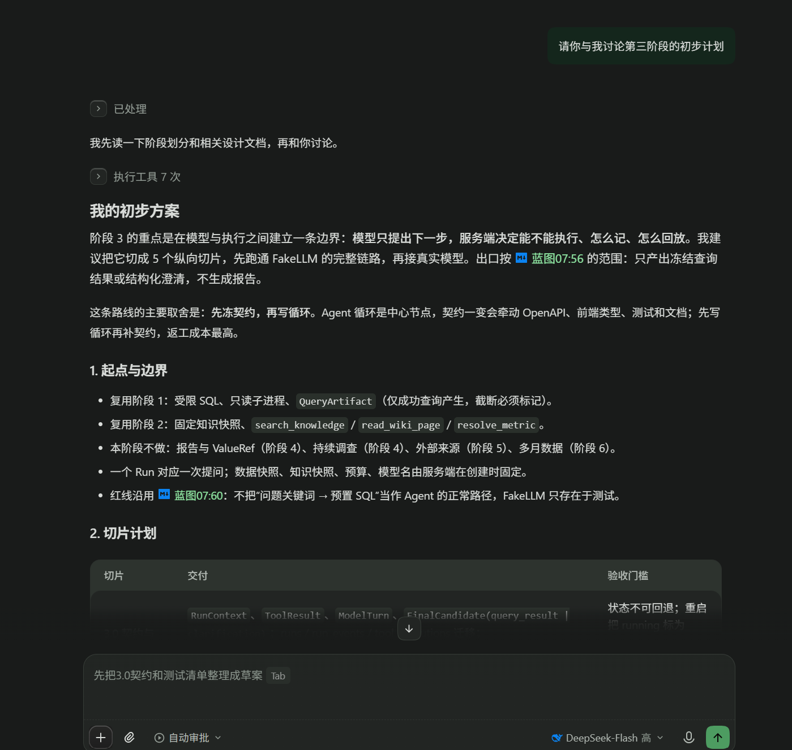
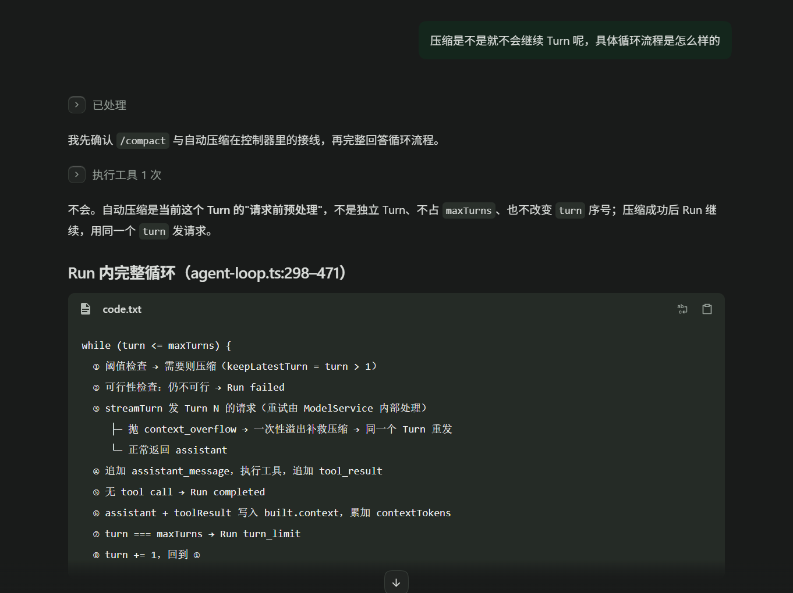

# A-Business-Aware-Data-Analysis-Agent：让每个业务结论，都能回到数据依据

## 1. 自我介绍

我们是陈文浩和卢逸峰，华南理工大学的2024级本科生。我喜欢把业务问题拆成三件事：数据能回答什么、现有证据能支持什么、还有什么暂时无法确定。A-Business-Aware-Data-Analysis-Agent 就是我把这个思路做成完整产品的实践。

## 2. 我的作品是什么

**A-Business-Aware-Data-Analysis-Agent 是一款面向航班运营分析人员的本地 AI 调查工作台：他们用自然语言提出取消率、延误、机场或航司比较等问题，系统会查阅业务资料、执行受控 SQL，并根据真实结果继续核查，最终生成每个数字都能回查依据的报告。**

它不是“问一句、给一段话”的聊天机器人，而是一条完整的调查链路：

**提出目标 → 查阅资料与数据 → 按结果继续核查 → 保存证据与限制 → 生成可追溯报告 → 在同一调查中继续追问。**

当前演示数据采用 BTS Reporting Carrier 月度航班数据，并可结合已登记的天气观测和 FAA ATCSCC 公告进行外部核查。

## 3. 为什么做

传统 BI 擅长回答固定报表，通用聊天机器人擅长组织语言，但两者之间往往缺少一段可靠的过程：

- 业务口径没有随问题一起固定，容易换一个分母就得出不同结论；
- 模型能生成流畅解释，却可能编造名次、因果或没有出处的数字；
- 一次查询失败、资料缺失或范围变化后，后续回答容易丢失上下文；
- 报告看起来完整，但评委或使用者无法回查“这个数究竟从哪里来”。

我想做的，是一个**让模型决定下一步、让系统守住执行和证据边界**的分析助手。模型负责理解目标、选择工具和根据结果调整调查方向；服务端负责校验 SQL、固定数据版本、保存成功产物，并从冻结结果中取出报告数字。失败、缺资料和无法确定的判断也会被如实保留，而不是被包装成成功。

## 4. 怎么用

以下步骤可在 Windows PowerShell 中直接执行。准备环境：Python 3.12、uv、Node.js 22+，以及一个支持原生工具调用的 Chat Completions 兼容模型服务。

### 第 1 步：安装依赖并配置模型

在项目根目录执行：

```powershell
$OutputEncoding = [Console]::OutputEncoding = [System.Text.UTF8Encoding]::new()
$env:UV_CACHE_DIR = Join-Path (Get-Location) '.cache/uv'
uv sync --locked
if (-not (Test-Path .env)) { Copy-Item .env.example .env }
```

编辑 `.env`，填写自己的模型配置：

```dotenv
LLM_BASE_URL=https://your-provider.example/v1
LLM_API_KEY=replace-me
LLM_MODEL=your-tool-capable-model
```

### 第 2 步：初始化数据库并导入演示数据

```powershell
uv run alembic upgrade head
uv run python -m metric_pilot.data.ingest --input ./fixtures/synthetic_flight_records.csv --period 2026-01 --synthetic --carriers ./fixtures/synthetic_airline_lookup.csv --airports ./fixtures/synthetic_airport_lookup.csv --activate
```

仓库附带的合成数据适合快速体验，不是官方航班数据，不能用于真实业务结论。

### 第 3 步：启动后端

保持项目根目录，运行：

```powershell
uv run uvicorn metric_pilot.main:app --host 127.0.0.1 --port 8000
```

### 第 4 步：启动前端

另开一个 PowerShell 终端：

```powershell
Set-Location frontend
npm.cmd ci --cache ../.cache/npm
npm.cmd run dev
```

### 第 5 步：打开页面，发起第一次调查

访问 **http://127.0.0.1:5173**，进入“分析”：

1. 在“工作区数据源”确认已选择刚导入的合成快照；
2. 点击“新调查”，选择日期范围，例如 `2026-01-01` 至 `2026-02-01`；
3. 输入问题：**“查看本月数据范围与缺失情况，找出值得进一步核查的异常。”**
4. 查看当前行动、工具结果和本轮发现；点击报告中的数字，打开 SQL、参数和冻结结果；
5. 在同一调查中继续追问，或导出 Markdown／JSON 报告。

更完整的安装、真实 BTS 数据接入与配置说明见 [README](README.md)。

## 5. 用 Qoder 做出来的过程

我没有把整个项目一次性丢给 Qoder，而是按“先定边界、再做纵向功能、每次验收后再继续”的方式推进。Qoder 承担了大量实现、排错、测试和文档工作；产品口径、验收标准和关键取舍由我决定。

| 开发环节 | 我负责决定什么 | 交给 Qoder 做什么 |
| --- | --- | --- |
| 产品定位 | 聚焦 BTS Reporting Carrier 航班调查，不做万能表格导入 | 把目标整理成模块边界、数据契约和可运行启动流程 |
| 数据与查询 | 必须只读、必须固定快照、不能用 `startswith('SELECT')` 冒充 SQL 校验 | 实现数据接入、多月快照、SQL AST 校验、只读执行、超时取消和冻结产物 |
| Agent 调查 | 模型可以选择下一步，但权限、ID、预算和报告取值由服务端控制 | 实现运行循环、工具注册、事件流、续查、上下文压缩和证据归属校验 |
| 报告与知识 | 数字必须能回查；正式指标必须人工审核；旧报告不能随规则更新而改变 | 实现 ValueRef 取值、报告冻结、版本与导出、文档管理及 Wiki 展示 |
| 页面与体验 | 页面要围绕“目标、行动、发现、依据、限制”展开，技术细节按需查看 | 实现分析、知识、报告页面，证据抽屉、移动端适配和 A-Business-Aware-Data-Analysis-Agent 品牌视觉 |
| 测试与验收 | 自动检查通过不等于业务语义正确，关键数字要用独立 CSV 复核 | 补单测、类型检查、构建、浏览器流程和真实模型试用，并记录失败样本 |

### 我重点改了什么

1. **把“通用数据导入”收窄为“BTS 航班调查”**：先保证一个真实场景能走通，不假装支持任意业务表。
2. **不让模型自己宣布结论正确**：排名和同列高低关系改由服务端基于完整冻结结果计算；自由解释默认放入“未核实解释”。
3. **把引用有效和语义正确分开**：数字能回查，只证明取值有依据，不自动证明分母、比较范围或因果正确。
4. **保留失败和旧版本**：失败样本、被拒绝的报告和旧报告不删除、不改写；新数据或规则不会悄悄重算历史结论。
5. **持续修正实际使用中发现的问题**：包括分组身份、缺侧比较、报告首段、长历史压缩、移动端阅读和前端品牌更名。

### 截图凭证

以下均为开发过程中保存的真实页面截图，使用合成数据，不包含模型密钥。截图拍摄于 2026-11-17，早于最终的 A-Business-Aware-Data-Analysis-Agent 品牌更名，因此页面标题仍显示“分析工作台”；功能路径和最终版本一致。

**① 分析入口：固定数据快照和日期范围后再发起调查**



**② 数字取证：点击报告数字，查看 SQL、参数、统计口径和冻结结果**



**③ 外部核查：把 FAA 公告和天气观测作为固定来源展示，并保留覆盖限制**


**④ 完整报告：保留调查范围、版本、导出和继续修订入口**



### Qoder 开发流程
1. 先讨论 `AGENTS.md` 怎么写，约束工作流  
   
2. 先讨论第一阶段的任务  
   
3. 讨论接入 api 的 sdk 是否该用 `httpx`外的模块  
   
4. 讨论第二阶段该怎么做  
   
5. 讨论第三阶段怎么做  
   
6. 讨论第四阶段的目标以及实现思路  
   
7. 讨论工具的约束以及如何让 agent 受控  
   
8. 与 qoder 讨论具体的压缩算法  
   
9. 讨论最后的收尾阶段  
   
