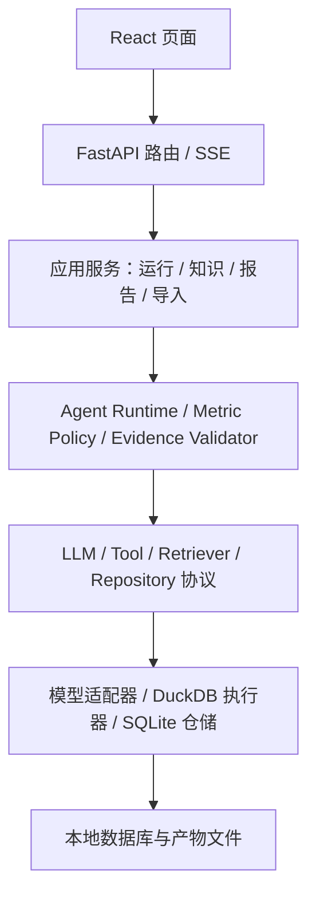

# 01 架构与技术分层

## 1. 默认技术组合

| 层 | 选择 | 理由 |
| --- | --- | --- |
| 前端 | React + TypeScript + Vite、Ant Design、ECharts | 独立于后端启动，快速实现对话、表格、抽屉和基础图表 |
| API | Python 3.11+、FastAPI、Pydantic v2 | 明确契约，异步事件接口，方便测试与类型校验 |
| 元数据 | SQLite + SQLAlchemy + Alembic | 保存会话、运行、知识版本、任务与报告；本地部署简单 |
| 业务分析 | DuckDB | 适合数十万行 CSV 的聚合与关联，数据文件可离线分发 |
| SQL 解析 | sqlglot，DuckDB 方言 | 基于 AST 检查语句、表引用和函数，而非字符串匹配 |
| 模型接口 | 一个支持工具调用的 OpenAI 兼容 HTTP 服务，SDK 封装在 adapter 中 | 保留一个适配入口；不要假定所有兼容服务均支持相同参数 |
| 检索 | SQLite FTS5 + embedding 向量余弦相似度 + RRF | 数十至数百文档无需独立向量数据库 |
| 文件 | 本地内容寻址文件目录 | 原文、查询结果、导入清单、报告快照可核对 |
| 验证 | pytest；前端 Vitest；少量 Playwright | 优先验证规则、查询与证据正确性 |

依赖版本由实现时按兼容性实际安装和验证后写入锁文件。此文档不凭空指定未测试的版本。前端统一 npm，后端统一 uv。FTS5 启动时自检；缺失就显示明确诊断，不悄悄退化成“混合检索”。

## 2. 分层图



路由不写提示词和 SQL 防护；Agent 不直接操作 HTTP；报告不直接重新执行 SQL；工具不决定页面样式。共用 Pydantic DTO 可以放在边界层，业务实体避免绑定 FastAPI Request。

## 3. 建议目录

以下是未来实施时的建议结构，并非现有文件清单。当前工作区包含根目录 `AGENTS.md` 和 `参考/` 资料目录；蓝图实际位于 `参考/docs/blueprint/`。其余目录、配置和状态文件需要实施时创建。

```text
metric-pilot/
  AGENTS.md
  README.md
  IMPLEMENTATION_STATUS.md
  .env.example
  .gitignore
  pyproject.toml
  uv.lock
  backend/
    src/metric_pilot/
      main.py
      settings.py
      api/                 # runs / knowledge / reports / sources
      application/         # 服务编排和事务边界
      agent/
        contracts.py
        runtime.py
        context.py
        middleware.py
        prompts.py
        tools/             # 知识、结构、查询、产物读取
      knowledge/           # 文档处理、检索、Wiki、MetricDefinition
      evidence/            # 查询产物、报告契约、校验与物化
      data/                # 清单、导入、目录、SQL guard、子进程执行
      infrastructure/
        llm/
        persistence/
        jobs/
        artifacts/
    migrations/
    tests/
  frontend/src/
    api/                   # DTO、fetch、SSE parser
    pages/                 # Knowledge / Analysis / Report
    components/            # WikiReader / RunTimeline / EvidenceDrawer
    state/
  scripts/                 # ingest_bts / seed_demo / evaluate
  evals/                   # 问题集、gold SQL、结果和摘要
  fixtures/                # 小型合成数据，明确标记
  参考/
    README.md
    docs/blueprint/
  storage/                 # gitignore
    metadata.sqlite
    datasets/<snapshot_id>/analytics.duckdb
    artifacts/<sha256>.json
    documents/<sha256>.txt
```

## 4. 核心对象与关系

所有 ID 由服务端生成。时间戳按 UTC 存储，前端按用户时区展示；航班运行日期与地方时间字段保留业务原义，不用服务端时区重新解释。

| 对象 | 关键字段 |
| --- | --- |
| DataSource | id, name, adapter, current_snapshot_id, status |
| DataSnapshot | id, source_id, file_hash, manifest, row_count, schema_hash |
| DocumentRevision | id, document_id, version, content_hash, origin_url, effective_from/to, source_kind |
| Chunk | id, revision_id, locator, text_hash, text, embedding_model_id |
| WikiRevision | id, page_id, version, content, citations, state, edit_source |
| MetricRevision | id, metric_key, version, definition_json, citations, review_state |
| Run | id, conversation_id, question, snapshot_id, knowledge_snapshot_id, status, budget |
| RunEvent | run_id, seq, type, payload, created_at |
| ToolExecution | id, run_id, tool_call_id, name, arguments, status, error, duration_ms |
| QueryArtifact | id, run_id, execution_id, snapshot_id, sql, params, result_hash, rules, stats |
| ReportRevision | id, report_id, run_id, version, content_hash, frozen_content, created_at |
| Job | id, kind, entity_id, state, attempt, error |

`knowledge_snapshot_id` 是本次运行可见的文档/Wiki/指标修订 ID 清单。一个清单不必复制原文，但其引用的修订不可物理删除。编辑新规则不会改变已开始的运行。

## 5. 应用边界

- 一个工作区，一次运行只选择一个数据快照。
- 一个 API 进程，一个有监督的后台 worker；原型也可由 API lifespan 启动该 worker。
- Job 表持久化，worker 串行领取知识处理任务；Agent 并发先限制为 1。
- 领取任务、状态转换用事务。进程重启后将原 `running` 运行标记为 `interrupted`，而不是自动从中间模型消息继续。
- 文档生成任务允许手动重试，使用输入 revision hash 作幂等键，避免重复生成。
- 长耗时任务不能只依赖一次 HTTP 请求或 FastAPI BackgroundTasks 的内存状态。
- SQLite 开 WAL、busy timeout、短事务；不要跨模型请求持有数据库事务。

## 6. 配置与启动契约

```dotenv
# .env.example，只放占位值
APP_HOST=127.0.0.1
APP_PORT=8000
STORAGE_DIR=./storage
LLM_BASE_URL=https://your-provider.example/v1
LLM_API_KEY=replace-me
LLM_MODEL=your-tool-capable-model
EMBEDDING_BASE_URL=https://your-provider.example/v1
EMBEDDING_API_KEY=replace-me
EMBEDDING_MODEL=your-embedding-model
RUN_MAX_TURNS=16
RUN_MAX_TOOL_CALLS=24
RUN_TIMEOUT_SECONDS=180
SQL_TIMEOUT_SECONDS=10
SQL_MAX_ROWS=1000
```

服务启动校验配置但不打印密钥。模型凭据缺失时健康检查仍可用，模型相关按钮显示未配置。真实模型连通性检查是独立操作，不能每次启动重复付费调用。

目标启动命令（实现后应实测）：

```powershell
uv sync
Copy-Item .env.example .env
uv run alembic upgrade head
uv run python -m metric_pilot.data.ingest --input ./data/bts.csv --period 2026-01
uv run uvicorn metric_pilot.main:app --host 127.0.0.1 --port 8000
```

另一个终端进入 `frontend` 执行 `npm ci`、`npm run dev`。Vite 固定 5173，开发代理 `/api` 到 8000。命令依赖项目根的包发现配置与 Alembic 配置，阶段 0 必须补齐。Windows/Linux 都测试；不在 npm scripts 使用 Windows 不支持的 `NAME=value command` 写法。

## 7. 扩展边界

只为确实存在的变化定义协议：LLMClient、Tool、Retriever、QueryExecutor、ArtifactStore。先实现一个 adapter，不创建全能插件容器。业务表只有 DuckDB；SQLite 是应用元数据，不算第二种对外分析数据源。
