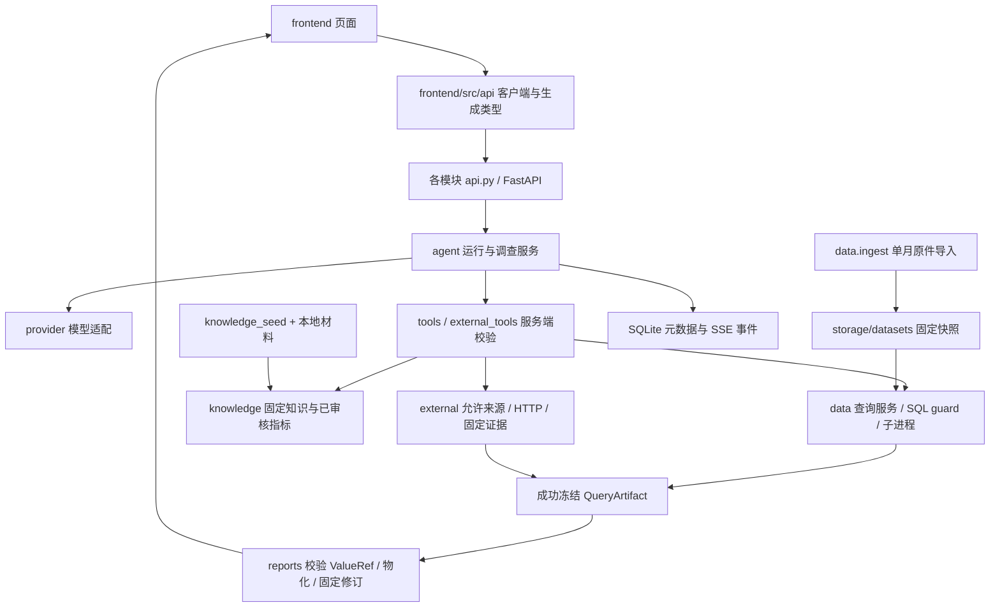

# 项目目录、文件作用与关系

本文按当前源码整理，供新协作者定位文件。功能是否完成、验证到什么程度，以 [实施与验证日志](IMPLEMENTATION_STATUS.md) 中对应事项的最新记录为准；未来设计见 [设计蓝图](docs/design/README.md)。开发流程见 [开发说明](开发说明.md)。

## 根目录与资料

以下树列出职责目录和主要文件；依赖、缓存、原件及运行产物按目录说明，不展开每个生成文件。`__init__.py` 是 Python 包标记，测试、迁移和讲解文档按类别归组。

```text
项目根目录/
├── README.md                      安装、配置、数据准备与使用入口
├── 项目目录说明.md                本文：文件职责和模块关系
├── 开发说明.md                    新协作者阅读、开发、验证与交付流程
├── AGENTS.md                      整个工作区的编码 AI 约束与工程边界
├── IMPLEMENTATION_STATUS.md        每次修改的时间、内容、验证与限制
├── pyproject.toml                 Python 包、依赖、pytest/Ruff 配置
├── uv.lock                        后端依赖锁定结果
├── .python-version                项目 Python 版本
├── alembic.ini                    数据库迁移入口配置
├── .env.example                   环境变量示例，无真实凭据
├── .env                           本机配置与密钥，不提交
├── .gitignore                     数据、密钥、缓存和生成产物排除规则
├── .agents/skills/                项目内编码技能说明
├── .vscode/                       编辑器配置
├── .venv/                         安装生成的 Python 环境
├── backend/                       后端，详见下节
├── frontend/                      页面与 API 客户端，详见下节
├── docs/
│   ├── README.md                  统一文档导航
│   ├── design/
│   │   ├── README.md              设计目标、阅读顺序和取舍索引
│   │   ├── 01-architecture.md     架构、职责与配置契约
│   │   ├── 02-agent-runtime.md    模型/工具循环、预算、上下文与运行状态
│   │   ├── 03-data-and-sql.md     BTS 来源、字段、快照与 SQL 防护
│   │   ├── 04-knowledge-and-metrics.md  文档、检索、Wiki 与指标审核
│   │   ├── 05-evidence-and-reports.md  冻结证据、ValueRef 与报告
│   │   ├── 06-ui-and-api.md       页面、API、SSE 与交互契约
│   │   ├── 07-build-and-evaluate.md    阶段 6—8 计划与验收要求
│   │   ├── 08-code-reading-map.md     按执行流程定位当前源码
│   │   └── assets/               设计示意图的 PNG/SVG
│   └── walkthroughs/             阶段 0—5.D 讲解及6.A/6.B实现入口，README为索引
├── fixtures/
│   ├── README.md                 合成样本的用途和边界
│   ├── synthetic_flight_records.csv   合成航班记录
│   ├── synthetic_airline_lookup.csv   合成航空公司对照表
│   ├── synthetic_airport_lookup.csv   合成机场对照表
│   └── synthetic_airport_lookup_invalid_duplicate_ids.csv  故意重复键的错误样本
├── knowledge_seed/
│   ├── README.md                 初始资料准备与导入说明
│   ├── manifest.json             材料路径、来源、哈希与导入清单
│   ├── metrics.draft.json        初始项目指标草稿，不代表已审核
│   └── project/                  项目指标政策、数据限制与分析使用说明
├── data/                         本地真实资料，不随源码提交
│   ├── bts/YYYY-MM.csv            BTS Reporting Carrier 月度原件
│   ├── knowledge_sources/        业务知识来源原件
│   └── knowledge_prepared/       人工整理、供种子导入的材料
├── storage/                      本地持久化状态与证据，不随源码提交
│   ├── metadata.sqlite           SQLite 元数据：版本、运行、事件、授权等
│   ├── metadata.sqlite-wal / -shm SQLite 运行时辅助文件，不手动清理
│   ├── datasets/                 固定数据快照、DuckDB 与导入清单
│   ├── artifacts/                按内容哈希保存的冻结查询结果、报告等
│   ├── external/                 外部来源留存文件
│   └── validation/               定向验收、失败记录及隔离验证产物
└── scripts/                      契约导出、隔离浏览器服务与定向验收脚本
```

`.git/` 保存版本历史。`.cache/`、`__pycache__/`、`frontend/dist/`、测试输出等可能由命令生成，不是业务源码。真实文件到位不代表已核验或已导入；6.A提供原件核验，6.B增加独立多月导入入口并保留单月兼容，调查范围与跨期口径仍待6.C—6.E。

## 后端源码

```text
backend/
├── migrations/
│   ├── env.py / script.py.mako     迁移运行环境与新迁移模板
│   └── versions/0001—0008_*.py     基础、数据、知识、Agent、报告、调查、外部证据及多月迁移
├── tests/
│   ├── test_*.py                  数据、SQL、知识、运行、调查、报告与外部证据测试
│   └── browser_*.py               隔离浏览器验收专用模型和来源替身
└── src/metric_pilot/
    ├── main.py                    FastAPI 应用、路由注册与生命周期
    ├── settings.py                环境变量配置与本地配置检查
    ├── database.py                SQLite 连接、会话和基础模型设施
    ├── contracts.py               通用 API 契约
    ├── agent/
    │   ├── api.py                 会话、运行、调查、取消及 SSE 接口
    │   ├── runtime.py             后台 worker、模型/工具循环与收尾
    │   ├── context.py             提示词、目标/范围与上下文裁剪
    │   ├── provider.py            文本模型 HTTP 请求与响应解析
    │   ├── tools.py               工具签名、注册和服务端执行校验
    │   ├── external_tools.py      受控天气、公告等工具接入
    │   ├── investigations.py      调查、发现、累计额度及旧证据授权
    │   ├── store.py               运行、事件、工具执行记录的持久化
    │   ├── middleware.py          生命周期观测、事件和审计
    │   ├── titles.py              会话短标题提取与清理
    │   └── contracts.py / models.py   运行与调查 DTO / ORM 模型
    ├── data/
    │   ├── ingest.py              BTS 单月导入 CLI、质量检查与新快照发布
    │   ├── audit.py               6.A 原件离线核验 CLI、来源与质量清单，不登记快照
    │   ├── multimonth.py          6.B 多月快照 CLI、来源定位、取消/超时与原子发布
    │   ├── catalog.py / api.py     数据目录、快照、结构及激活接口
    │   ├── query.py               查询权限、执行编排与成功产物登记
    │   ├── guard.py               SQL AST、表、函数与作用域允许集
    │   ├── executor.py            受限只读 DuckDB 子进程、超时及真实取消
    │   ├── serialization.py       结果序列化、精确数值与大小控制
    │   ├── common.py              数据路径、哈希等公共处理
    │   └── contracts.py / models.py   RunContext、ToolResult、QueryArtifact 等契约 / 元数据模型
    ├── knowledge/
    │   ├── api.py / store.py       知识管理 API 与存储
    │   ├── documents.py           原文修订、分块和来源定位
    │   ├── retrieval.py / relevance.py 检索、排序与相关性处理
    │   ├── wiki.py / graph.py      Wiki 草稿、发布修订与引用关系图
    │   ├── metrics.py             指标草稿、审核、适用期及解析
    │   ├── jobs.py / provider.py   持久任务与知识模型服务适配
    │   ├── seed.py                读取 knowledge_seed 清单的导入 CLI
    │   └── contracts.py / models.py   知识 DTO / ORM 模型
    ├── external/
    │   ├── registry.py / http.py   来源/站点允许集与受控 HTTP、预算及取消
    │   ├── weather.py             天气获取、解析及覆盖处理
    │   ├── weather_proof.py        天气来源证明与核验处理
    │   ├── weather_snapshot.py     天气查询快照与发布生命周期
    │   ├── advisories.py / advisory_parser.py  公告检索、正文与解析
    │   ├── evidence.py            外部来源冻结、版本与证据关联
    │   ├── cli.py / advisory_cli.py    天气 / 公告手动核查 CLI
    │   └── models.py              外部来源与证据元数据模型
    └── reports/
        ├── api.py / service.py     报告接口、验证、保存与修订
        ├── values.py              ValueRef 从成功冻结结果取值
        ├── sources.py             来源证据解析与展示信息
        ├── materialize.py         将报告草稿物化为固定内容
        └── contracts.py / models.py   ReportDraft 等契约 / 报告存储模型
```

`contracts.py` 定义模块边界数据，`models.py` 定义数据库持久化结构，两者修改影响不同。数据库结构变化通过 Alembic 新迁移实施；不能仅改 DTO 就当数据库已升级。

## 前端与脚本

```text
frontend/
├── package.json / package-lock.json  npm 命令、依赖与锁文件
├── index.html / tsconfig.json        HTML 入口与 TypeScript 配置
├── vite.config.ts / vitest.config.ts 开发代理、构建与单元测试配置
├── playwright*.config.ts            通用、分析、知识浏览器测试配置
├── openapi.json                     从后端导出的 API 契约
├── src/
│   ├── main.tsx / App.tsx            React 挂载、路由与页面框架
│   ├── style.css / vite-env.d.ts     样式与 Vite 类型声明
│   ├── api/
│   │   ├── schema.d.ts              从 openapi.json 生成的类型
│   │   ├── client.ts               HTTP 与 SSE 通信基础
│   │   ├── eventLog.ts             历史执行记录读取、响应校验与分类错误
│   │   ├── runHistory.ts           运行归组、事件分页、读取队列与冻结内容缓存
│   │   └── analysis.ts / data.ts / knowledge.ts / reports.ts  各领域 API 客户端
│   └── components/
│       ├── AnalysisPage.tsx / ConversationItem.tsx  分析工作区与会话列表项
│       ├── RunTurn.tsx             逐轮进度、历史日志与按需结果读取
│       ├── RunDetails.tsx          本轮发现、运行信息及固定数据与依据
│       ├── InvestigationPanel.tsx  调查汇总信息、汇总/逐轮发现与后续核查
│       ├── investigationPresentation.ts  发现修正归组与实际引用来源筛选
│       ├── ExecutionTrace.tsx / executionPresentation.ts  执行进度、耗时及展示转换
│       ├── DataSourceDrawer.tsx    工作区数据管理与逐轮固定快照只读查看
│       ├── EvidenceDrawer.tsx / ExternalSource.tsx  报告依据与外部来源
│       ├── ReportsPage.tsx / ReportChart.tsx       报告阅读及图表
│       ├── KnowledgePage.tsx / KnowledgeGraph.tsx  文档、Wiki 及关系图
│       ├── MetricSummary.tsx / knowledgePresentation.ts  指标与知识展示转换
│       ├── ReadableMarkdown.tsx / ExplorationNote.tsx    Markdown 与探索身份说明
│       └── *.test.ts / *.test.tsx   与客户端/组件相邻的单元测试
├── tests/                           Playwright 浏览器流程测试
└── node_modules/                    安装生成的依赖，含 Vite 运行缓存

scripts/
├── export_openapi.py                 无需启动服务即可导出 API 契约
├── browser_analysis_server.py        分析浏览器测试隔离服务
├── browser_knowledge_server.py       知识浏览器测试隔离服务
├── summarize_conversation_titles.py  既有会话短标题整理工具
└── verify_*.py                       按职责进行真实或定向验收，运行前核对参数和副作用
```

`verify_*.py` 包括 BTS 基线、Agent、知识阅读、报告、调查、探索、天气、公告、外部证据、取消、续查和重试恢复。其中 `verify_bts_audit.py` 用既有独立原始 CSV 基线复核 6.A 清单，只读取原件并独占写入指定验收文件，不连接应用数据库。其他脚本的前提不同，不能一律当作离线测试批量执行；有些会访问真实模型/来源并写入验收产物。

## 模块怎样协作



一次提问从 `AnalysisPage.tsx` 经 `api/analysis.ts` 到 `agent/api.py`，服务端固定范围、版本和预算后交给 `runtime.py`。模型选择工具，工具调用各领域服务；只有成功查询生成可引用产物。报告服务从产物取值并保存固定修订，前端通过 API/SSE 展示状态和依据。SSE 更新进度，完整结果通过对应接口读取。

前端由 `AnalysisPage.tsx` 管理调查选择、发送目标与页内草稿，`RunTurn.tsx` 按调查归属连续展示各轮问题和结果，仅活动运行订阅 SSE，历史日志通过 `eventLog.ts` 与 `runHistory.ts` 按需分页。`RunDetails.tsx` 保留每轮发现、信息和固定数据入口，`InvestigationPanel.tsx` 共用汇总与逐轮发现展示；修正关系和引用来源由 `investigationPresentation.ts` 归组筛选。`DataSourceDrawer.tsx` 在工作区入口管理默认数据版本，在逐轮入口锁定运行的固定快照只读查看。

SQLite 保存应用状态，DuckDB 查询业务快照，文件目录留存不可变内容。导入负责创建快照，运行负责使用固定快照，报告负责引用既有结果；它们分别承担写入、执行和证据职责。进一步逐函数追踪见 [蓝图 08](docs/design/08-code-reading-map.md) 和 [代码讲解](docs/walkthroughs/README.md)。
